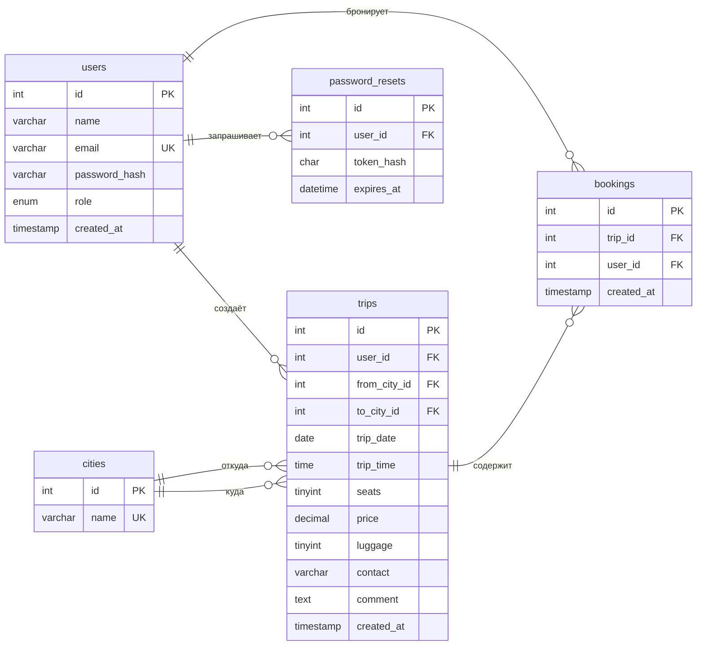
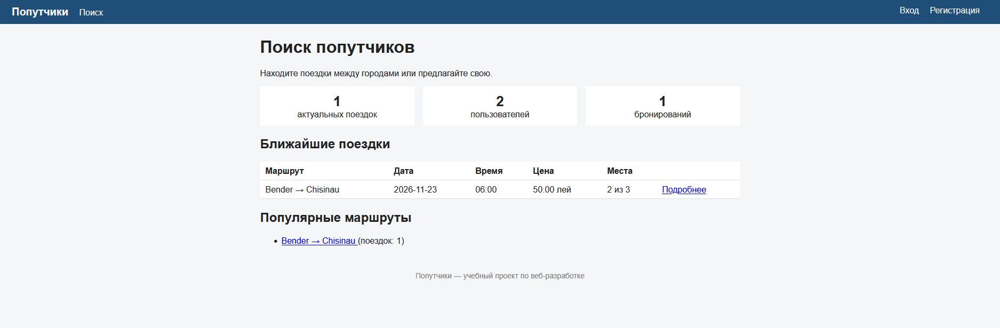
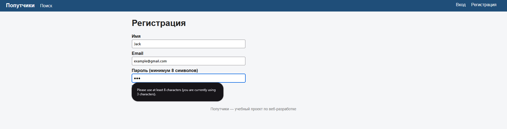
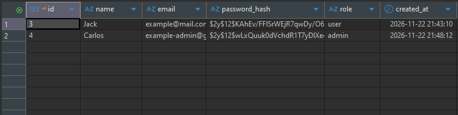
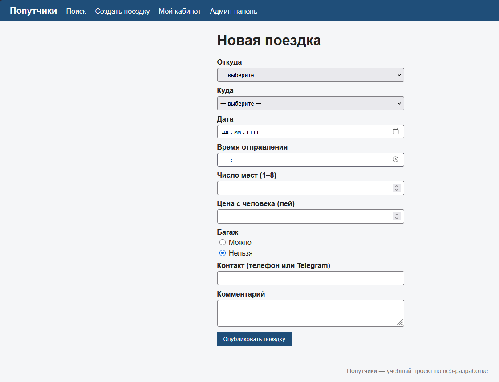
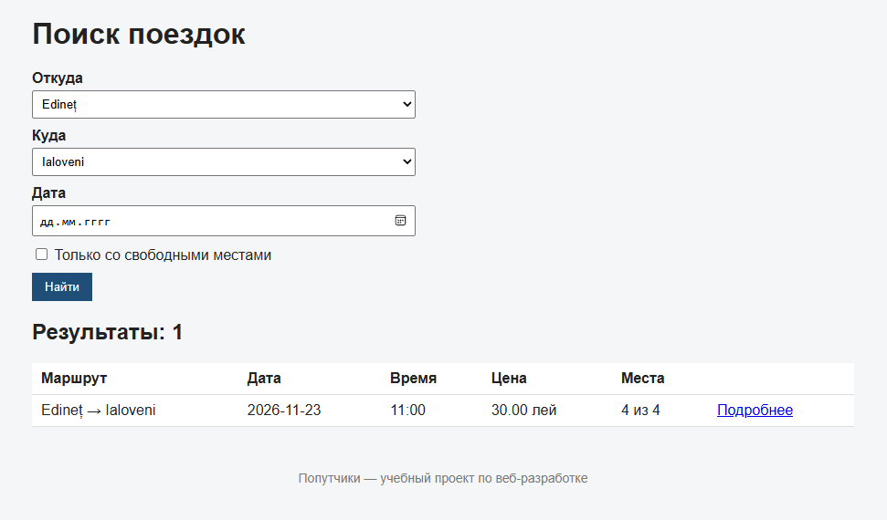
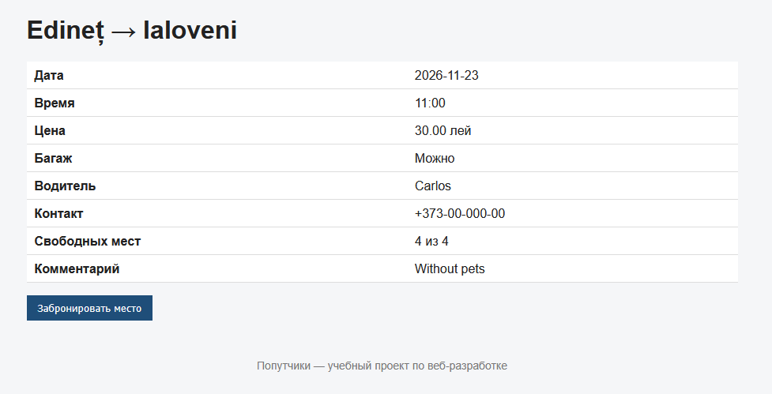
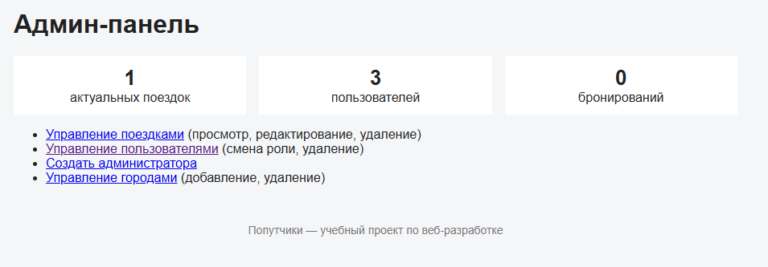
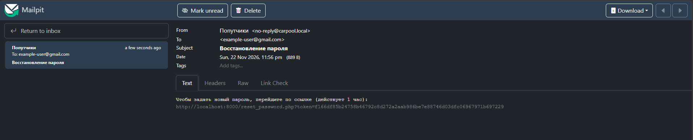

# Попутчики — веб-приложение для поиска попутчиков

Индивидуальная работа по предмету «Dezv. WEB» (PHP).
Студент: Cerbul Alexei, группа IA2503. Репозиторий: https://github.com/MassaroBoys/carpool-

## Содержание

1. [Цель и задача](#цель-и-задача)
2. [Запуск проекта](#запуск-проекта)
3. [Функциональные возможности](#функциональные-возможности)
4. [Регистрация и вход в систему](#регистрация-и-вход-в-систему)
5. [Сценарии взаимодействия](#сценарии-взаимодействия)
6. [Структура базы данных](#структура-базы-данных)
7. [Структура проекта](#структура-проекта)
8. [Безопасность](#безопасность)
9. [Примеры использования](#примеры-использования)
10. [Выводы](#выводы)
11. [Список использованных источников](#список-использованных-источников)

## Цель и задача

Разработать серверное веб-приложение средней сложности: аутентификация с хешированием паролей,
публичный раздел с данными из БД, форма создания ресурса (от 5 полей, проверка на клиенте и сервере),
форма поиска, защищённая зона с ролью администратора.

Тема: сервис, где водители публикуют поездки между городами, а пассажиры ищут их и бронируют места.

## Запуск проекта

Требования: PHP 8+ с расширением `pdo_mysql`, MySQL 8, Docker (для тестового почтового сервера).

1. Создать базу: выполнить `sql/schema.sql` в MySQL (например, в DBeaver).
2. Скопировать `config.example.php` в `config.php` и указать параметры подключения к БД и почте.
   Для проверки восстановления пароля запустить тестовый почтовый сервер Mailpit
   (письма видны на `http://localhost:8025`):
   ```
   docker run -d --name mailpit -p 8025:8025 -p 1025:1025 axllent/mailpit
   ```
3. Запустить встроенный сервер из корня проекта:
   ```
   php -S localhost:8000 -t public
   ```
4. Открыть `http://localhost:8000`.
5. Первого администратора создать так: зарегистрироваться на сайте, затем выполнить в БД
   ```sql
   UPDATE users SET role = 'admin' WHERE email = 'ваш@email';
   ```
   Остальных администраторов можно создавать из админ-панели.

## Функциональные возможности

- **Аутентификация:** регистрация, вход, выход; пароли хранятся только в виде хеша (`password_hash`).
- **Восстановление пароля по email (доп. задание):** ссылка «Забыли пароль?» на странице входа, письмо
  с одноразовой ссылкой (действует 1 час), установка нового пароля. В БД хранится только хеш токена.
- **Публичный раздел** (главная страница, доступна без входа): статистика сайта, ближайшие поездки,
  популярные маршруты. Все данные берутся из БД.
- **Форма создания поездки** (7 полей: 2 выпадающих списка, дата, время, 2 числовых поля,
  переключатель, текстовые поля): проверка в браузере и на сервере, понятные сообщения об ошибках.
- **Форма поиска:** по городу отправления, городу назначения, дате и наличию свободных мест.
- **Бронирование мест:** число свободных мест = мест в поездке минус число броней;
  при нуле показывается «Мест нет». Нельзя бронировать собственную поездку и бронировать дважды.
- **Личный кабинет:** свои поездки (с пассажирами), свои брони, отмена брони, удаление поездки.
- **Админ-панель** (только роль `admin`):
  1. управление поездками (просмотр, редактирование, удаление);
  2. управление пользователями (смена роли, удаление);
  3. создание новых администраторов;
  4. управление городами (добавление, удаление).

## Сценарии взаимодействия

1. **Гость:** открывает главную, смотрит поездки, пользуется поиском; контакт водителя скрыт до входа.
2. **Пассажир:** регистрируется, входит, находит поездку через поиск, бронирует место, при необходимости отменяет бронь в кабинете.
3. **Водитель:** входит, создаёт поездку через форму, в кабинете или на странице поездки видит список пассажиров.
4. **Администратор:** входит, открывает админ-панель, редактирует или удаляет поездки, меняет роли, добавляет города.

## Структура базы данных

| Таблица | Поля |
|---|---|
| `users` | id, name, email (уникальный), password_hash, role (`user`/`admin`), created_at |
| `cities` | id, name (уникальное) |
| `trips` | id, user_id → users, from_city_id → cities, to_city_id → cities, trip_date, trip_time, seats, price, luggage, contact, comment, created_at |
| `password_resets` | id, user_id → users, token_hash (SHA-256 токена), expires_at |
| `bookings` | id, trip_id → trips, user_id → users, created_at; уникальная пара (trip_id, user_id) |

Связи: пользователь создаёт много поездок; поездка связана с двумя городами; пользователь бронирует
много поездок (связь «многие ко многим» через `bookings`). Удаление пользователя или поездки
каскадно удаляет связанные записи. Полный скрипт: `sql/schema.sql`.

### Схема связей (ER-диаграмма)



## Структура проекта

```
public/       страницы, доступные из браузера (index, register, login, search, trip, my, admin/...)
src/          классы: Database, Auth, Mailer, TripRepository, BookingRepository, CityRepository, UserRepository
src/lib/      библиотека PHPMailer (отправка писем)
templates/    общие части страниц: header, footer, таблица поездок, форма поездки
sql/          schema.sql
config.php    настройки подключения к БД (не попадает в git, образец — config.example.php)
```

Приложение построено модульно: логика и работа с БД вынесены в классы `src/`, страницы только
вызывают их и выводят результат. Код документирован в формате PHPDoc.

## Безопасность

- Пароли: `password_hash()` / `password_verify()`.
- SQL-инъекции: везде подготовленные запросы PDO (`ATTR_EMULATE_PREPARES = false`).
- XSS: весь выводимый пользовательский текст проходит через `htmlspecialchars()` (функция `e()`).
- Восстановление пароля: токен — `random_bytes(32)`, в БД только его хеш, срок действия 1 час, токен одноразовый, ответ не зависит от существования email.
- Сессии: данные о пользователе хранятся в `$_SESSION`, после входа вызывается `session_regenerate_id()`.
- Доступ: `Auth::requireLogin()` для кабинета и создания поездок, `Auth::requireAdmin()` для админ-зоны.
- Валидация: на клиенте (атрибуты HTML5 и JavaScript) и на сервере (`TripRepository::validate()`, `Auth::register()`).

## Примеры использования

### Главная страница (публичный раздел)


### Регистрация: проверка данных


### Пароли в БД хранятся в виде хеша


### Форма создания поездки


### Поиск поездок


### Бронирование мест


### Админ-панель


### Восстановление пароля: письмо со ссылкой


## Список использованных источников
1. PHP Manual. Функции для работы с паролями (`password_hash`, `password_verify`). https://www.php.net/manual/ru/book.password.php
2. PHP Manual. PHP Data Objects (PDO). https://www.php.net/manual/ru/book.pdo.php
3. PHP Manual. Сессии. https://www.php.net/manual/ru/book.session.php
4. MySQL 8.0 Reference Manual. https://dev.mysql.com/doc/refman/8.0/en/
5. OWASP Cheat Sheet Series. Forgot Password Cheat Sheet. https://cheatsheetseries.owasp.org/cheatsheets/Forgot_Password_Cheat_Sheet.html
6. OWASP Cheat Sheet Series. Password Storage Cheat Sheet. https://cheatsheetseries.owasp.org/cheatsheets/Password_Storage_Cheat_Sheet.html
7. OWASP Cheat Sheet Series. Cross-Site Request Forgery Prevention. https://cheatsheetseries.owasp.org/cheatsheets/Cross-Site_Request_Forgery_Prevention_Cheat_Sheet.html
8. phpDocumentor. Документация по PHPDoc. https://docs.phpdoc.org/
9. PHPMailer. Репозиторий и документация. https://github.com/PHPMailer/PHPMailer
10. Mailpit. Документация. https://mailpit.axllent.org/
